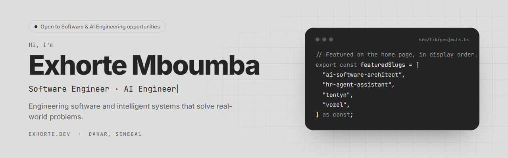
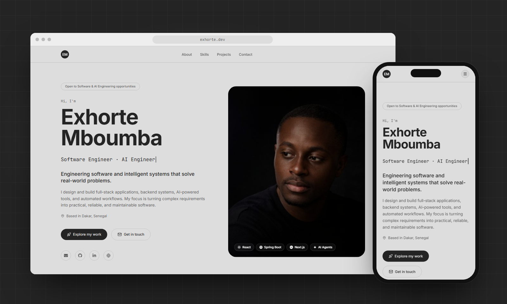
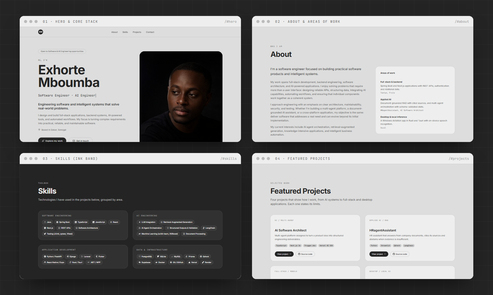
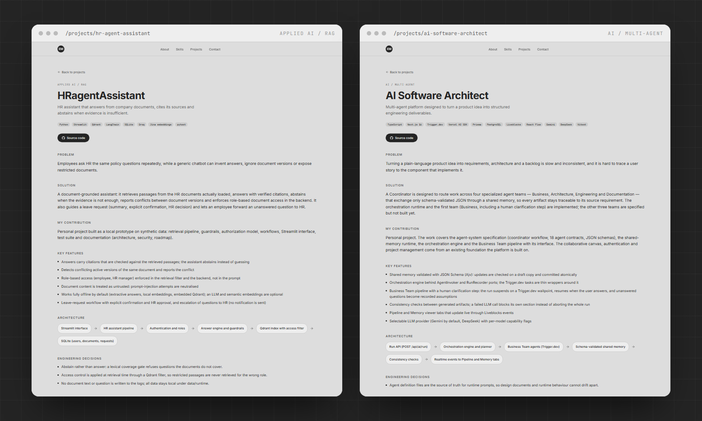
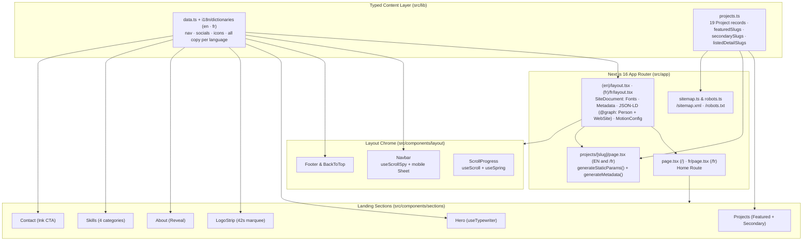
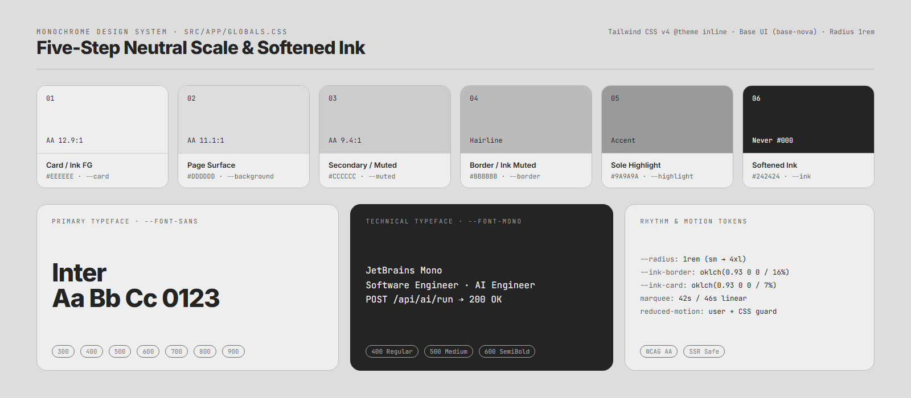
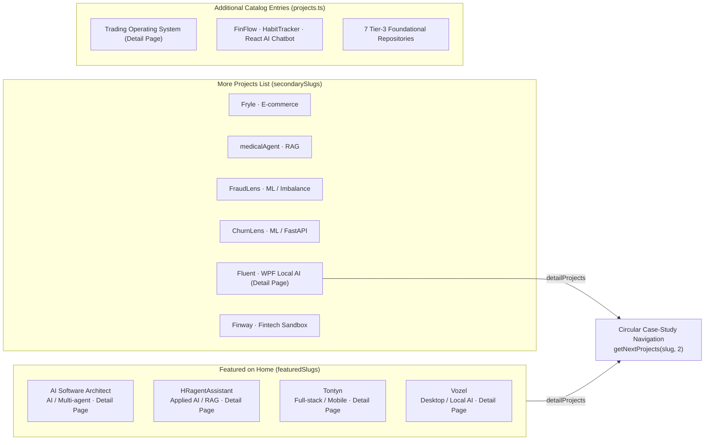

<div align="center">

<picture>
  <source media="(prefers-color-scheme: dark)" srcset="./docs/readme/banner-dark.png" />
  <source media="(prefers-color-scheme: light)" srcset="./docs/readme/banner-light.png" />
  
</picture>

<br />

[](https://exhorte.dev)
[](https://nextjs.org)
[](https://react.dev)
[](https://www.typescriptlang.org)
[](https://tailwindcss.com)
[](https://www.framer.com/motion/)

**Personal engineering portfolio of Exhorte Mboumba — Software Engineer · AI Engineer (Dakar, Senegal).**
A data-driven, statically prerendered Next.js 16 application presenting full-stack systems, backend architectures, applied AI / RAG pipelines, multi-agent orchestration, and local-inference desktop software — with verified claims and explicit engineering limitations on every case study.

[Live Portfolio](https://exhorte.dev) · [Architecture & Audit](./docs/PORTFOLIO_AUDIT.md) · [GitHub](https://github.com/exhorte) · [LinkedIn](https://www.linkedin.com/in/exhorte-baboka-boumba) · [ExponentValue](https://exponentvalue.com)

</div>

---

## Table of Contents

1. [Overview & Engineering Philosophy](#1-overview--engineering-philosophy)
2. [Visual Tour](#2-visual-tour)
3. [System Architecture](#3-system-architecture)
4. [Monochrome Design System](#4-monochrome-design-system)
5. [Project Catalog & Case-Study Engine](#5-project-catalog--case-study-engine)
6. [Accessibility, SEO & Performance](#6-accessibility-seo--performance)
7. [Repository Structure](#7-repository-structure)
8. [Getting Started](#8-getting-started)
9. [Content Authoring Guide](#9-content-authoring-guide)
10. [Deployment & Operations](#10-deployment--operations)

---

## 1. Overview & Engineering Philosophy

Most developer portfolios optimize for visual noise and unverified superlatives. This codebase was rebuilt from the ground up around a single editorial and engineering rule documented in [`docs/PORTFOLIO_AUDIT.md`](./docs/PORTFOLIO_AUDIT.md): **every claim on the site must be traceable to the source code and tests of the corresponding repository, and every featured system must state its known limitations.**

### Core Principles

| Principle | Implementation in Code |
| :--- | :--- |
| **Evidence over slogans** | Unsourced counters (`7+ projects`, `20+ technologies`) and generic badges were removed. Every featured project documents its `validation` suite and its concrete `limitations`. |
| **Single source of truth** | Every visible sentence lives in the two language dictionaries ([`en.ts`](./src/lib/i18n/dictionaries/en.ts), [`fr.ts`](./src/lib/i18n/dictionaries/fr.ts)), including the case-study texts of all 19 projects; [`src/lib/data.ts`](./src/lib/data.ts) holds navigation, social links, icons and skill structure, and [`src/lib/projects.ts`](./src/lib/projects.ts) holds slugs, tiers, stacks and links. |
| **Bilingual (EN / FR)** | English is served at the root (`/`, `/projects/[slug]`) and French under `/fr` (`/fr`, `/fr/projects/[slug]`). Each language has its own root layout so `<html lang>` is correct, and pages carry `hreflang` alternates. The navbar selector (`EN` / `FR`) switches language while keeping the current page and section. On English URLs only, an inline script ([`detect.ts`](./src/lib/i18n/detect.ts)) sends visitors whose browser prefers French to `/fr` before the first paint; a language chosen with the selector (`lang` cookie) always wins, so nobody gets stuck. |
| **Static-first App Router** | The landing page and every detail route, in both languages, are statically generated at build time via `generateStaticParams()`, serving zero-latency HTML with per-route canonical metadata. |
| **Editorial monochrome rhythm** | A strict five-step neutral grey scale (`#eeeeee` → `#9a9a9a`) paired with softened ink (`#242424`, never `#000000`) alternates between light surfaces and full-bleed dark rhythm bands. |
| **Accessible motion** | Framer Motion animations are wrapped in `<MotionConfig reducedMotion="user">`, reinforced by a global `@media (prefers-reduced-motion: reduce)` CSS guard and screen-reader-safe typewriter markup. |

---

## 2. Visual Tour

### Desktop & Mobile Responsive Views

<div align="center">
  
  <p><sub><b>Figure 1</b> — Desktop landing view (<code>1440×900</code>) and mobile viewport (<code>390×844</code>) rendered from the production Next.js build.</sub></p>
</div>

### Alternating Surface & Ink Rhythm Bands

The home page alternates between the warm neutral surface (`--background: #dddddd`) and full-bleed softened-ink bands (`--ink: #242424`) to separate narrative sections (`Hero`, `About`, `Projects`) from high-density technical sections (`LogoStrip`, `Skills`, `Contact`, `Footer`).

<div align="center">
  
  <p><sub><b>Figure 2</b> — The four primary home sections: <code>#hero</code>, <code>#about</code>, <code>#skills</code> (ink band), and <code>#projects</code>.</sub></p>
</div>

### Deep-Dive Engineering Case Studies (`/projects/[slug]`)

Each project with `hasDetailPage: true` renders a structured eight-part engineering breakdown — **Problem**, **Solution**, **My Contribution**, **Key Features**, **Architecture** (rendered as a directional step pipeline by [`ArchitectureFlow.tsx`](./src/components/ui/ArchitectureFlow.tsx)), **Engineering Decisions**, **Validation & Tests**, and **Limitations** — followed by circular navigation to the next case studies.

<div align="center">
  
  <p><sub><b>Figure 3</b> — Statically generated case-study routes: <code>/projects/hr-agent-assistant</code> and <code>/projects/ai-software-architect</code>.</sub></p>
</div>

---

## 3. System Architecture

### Technology Stack

| Layer | Technology | Version | Role in the Application |
| :--- | :--- | :--- | :--- |
| **Framework** | Next.js (App Router) | `16.3.1` | Server Components, static route generation (`SSG`), metadata API, `sitemap.xml` & `robots.txt` routes |
| **UI Runtime** | React / React DOM | `19.2.8` | Concurrent rendering, typed `LayoutProps` and `PageProps` route helpers |
| **Language** | TypeScript | `5.9.3` | Strict mode (`"strict": true`), typed project schema and icon contracts |
| **Styling** | Tailwind CSS + PostCSS | `4.3.3` | CSS-first `@theme inline` token mapping in [`src/app/globals.css`](./src/app/globals.css) |
| **UI Primitives** | shadcn/ui + `@base-ui/react` | `4.18.0` / `1.7.0` | `base-nova` style primitives (`Card`, `Badge`, `Button`, accessible mobile `Sheet` drawer) |
| **Motion** | Framer Motion | `13.1.0` | Scroll progress spring, viewport reveal transitions (`Reveal`), staggered project cards |
| **Icons** | Lucide React + React Icons | `1.31.0` / `5.7.0` | UI chrome icons (`lucide-react`) and Simple Icons / FontAwesome brand glyphs (`react-icons/si`, `fa6`) |
| **Typography** | `next/font/google` | — | Self-hosted `Inter` (`300`–`900`) and `JetBrains Mono` (`400`–`600`) with zero external font requests |

### Rendering & Data Flow



### Build-Time Prerendering Matrix

Running `npm run build` compiles and statically prerenders every public route:

```text
Route (app)                                 Rendering Mode
┌ ○ /                                       Static (Landing Page: Hero → LogoStrip → About → Skills → Projects → Contact)
├ ○ /fr                                     Static (same landing page, French)
├ ○ /_not-found                             Static (404 Page)
├ ● /projects/[slug]                        SSG via generateStaticParams() (6 case-study routes)
│ ├ /projects/ai-software-architect
│ ├ /projects/hr-agent-assistant
│ ├ /projects/tontyn
│ ├ /projects/vozel
│ ├ /projects/fluent
│ └ /projects/trading-operating-system
├ ● /fr/projects/[slug]                     SSG, the same 6 case studies in French
├ ○ /robots.txt                             Static MetadataRoute.Robots
└ ○ /sitemap.xml                            Static MetadataRoute.Sitemap (advertises home + listed detail pages)
```

---

## 4. Monochrome Design System

All visual tokens are declared in [`src/app/globals.css`](./src/app/globals.css) and exposed to Tailwind v4 utilities via `@theme inline`. No arbitrary hex values are scattered across section components.

<div align="center">
  
  <p><sub><b>Figure 4</b> — The five-step neutral palette (<code>#eeeeee</code> → <code>#9a9a9a</code>), softened ink (<code>#242424</code>), and dual typeface pairing (<code>Inter</code> + <code>JetBrains Mono</code>).</sub></p>
</div>

| CSS Variable | Value | Semantic Role |
| :--- | :--- | :--- |
| `--background` | `#dddddd` | Primary light page surface |
| `--card` / `--popover` | `#eeeeee` | Elevated card surface on light sections; foreground text on ink bands |
| `--secondary` / `--muted` | `#cccccc` | Badge fills, subtle hover states, and secondary containers |
| `--border` / `--input` | `#bbbbbb` | Hairline borders on light sections; muted copy on dark ink sections (`--ink-muted`) |
| `--highlight` / `--ring` | `#9a9a9a` | Sole mid-grey accent legible across both light surfaces and ink bands |
| `--foreground` / `--ink` | `#242424` | Softened black ink (never pure `#000`) used for typography and full-bleed dark sections |
| `--ink-border` | `oklch(0.93 0 0 / 16%)` | Translucent card and pill borders inside dark ink sections |
| `--ink-card` | `oklch(0.93 0 0 / 7%)` | Translucent surface fill for skill category cards on `--ink` bands |

---

## 5. Project Catalog & Case-Study Engine

The portfolio catalogs **19 engineering projects** in [`src/lib/projects.ts`](./src/lib/projects.ts), organized into three tiers and two curated display lists (`featuredSlugs` and `secondarySlugs`):



### Featured & Secondary Projects Summary

| Project | Category | Primary Stack | Case Study | External Links |
| :--- | :--- | :--- | :---: | :--- |
| **AI Software Architect** | AI / Multi-agent | TypeScript, Next.js 16, Trigger.dev, Vercel AI SDK, Prisma, PostgreSQL, Liveblocks | `/projects/ai-software-architect` | [GitHub](https://github.com/exhorte/ai-software-architect) |
| **HRagentAssistant** | Applied AI / RAG | Python, Streamlit, Qdrant, LangChain, SQLite, Groq, Jina embeddings, pytest | `/projects/hr-agent-assistant` | [GitHub](https://github.com/exhorte/HRagentAssistant) |
| **Tontyn** | Full-stack / Mobile | Java, Spring Boot, PostgreSQL, React, Flutter, JWT, Docker, DeepSeek API | `/projects/tontyn` | [GitHub](https://github.com/exhorte/TontyneApp) · [Live Demo](https://tontyn-frontend.vercel.app) |
| **Vozel** | Desktop / Local AI | Rust, Tauri 2, ONNX Runtime (Parakeet-TDT INT8), React, TypeScript, SQLite | `/projects/vozel` | [GitHub](https://github.com/exhorte/vozel) · [Website](https://vozelwebsite.vercel.app) |
| **Fryle** | Full-stack / E-commerce | Next.js, React 19, Prisma, PostgreSQL, Stripe Checkout, Tailwind CSS, Vitest | — | [GitHub](https://github.com/exhorte/Fryle) |
| **medicalAgent** | Applied AI / RAG | Python, FastAPI, LangChain, Pinecone, Groq, Gemini embeddings | — | [GitHub](https://github.com/exhorte/medicalAgent) |
| **FraudLens** | Machine Learning / Data | Python, scikit-learn, XGBoost, imbalanced-learn, Streamlit, pytest | — | [GitHub](https://github.com/exhorte/FraudLens) |
| **ChurnLens** | Machine Learning / Data | Python, scikit-learn, Streamlit, FastAPI, pytest, Docker | — | [GitHub](https://github.com/exhorte/ChurnLens) |
| **Fluent** | Desktop / Local AI | C#, .NET, WPF, Whisper, Gemini API, DeepSeek API, Supabase, SQLite | `/projects/fluent` | [GitHub](https://github.com/exhorte/Fluent) |
| **Finway** | Full-stack / Fintech | Next.js 16, React 19, TypeScript, Appwrite, Plaid (sandbox), Dwolla (sandbox) | — | [GitHub](https://github.com/exhorte/finway) |

---

## 6. Accessibility, SEO & Performance

- **Screen-reader-safe typewriter (`Hero.tsx`)**: The animated typewriter line (`useTypewriter`) is marked `aria-hidden="true"`, while a dedicated `<p className="sr-only">{copy.title}</p>` exposes the full static title (`Software Engineer · AI Engineer`, or its French equivalent) once to assistive technologies instead of announcing character-by-character mutations.
- **Reduced motion compliance**: Global `<MotionConfig reducedMotion="user">` in [`src/components/layout/SiteDocument.tsx`](./src/components/layout/SiteDocument.tsx) plus a CSS `@media (prefers-reduced-motion: reduce)` rule in [`src/app/globals.css`](./src/app/globals.css) disable marquee loops, smooth-scroll overrides, and transition durations when requested by the operating system.
- **Per-route canonicals & Open Graph**: [`src/lib/seo.ts`](./src/lib/seo.ts) builds, per language, `metadataBase: new URL("https://exhorte.dev")`, Open Graph image and locale metadata, Twitter card metadata, `alternates.languages` (`hreflang` en / fr / x-default) and a Schema.org `@graph` (`Person` + `WebSite` JSON-LD). Dynamic project pages override `alternates.canonical` with `/projects/${slug}` (or `/fr/projects/${slug}`) and set `openGraph.type = "article"` while inheriting the parent share image via `ResolvingMetadata`.
- **Search engine indexing (`sitemap.ts`)**: Only projects actively surfaced on the home page (`listedDetailSlugs` = featured + secondary with `hasDetailPage: true`) are advertised in `/sitemap.xml`, once per language with the `hreflang` alternates of each entry.

---

## 7. Repository Structure

```text
portfolio/
├── docs/
│   ├── PORTFOLIO_AUDIT.md              # Content audit, verification findings & implementation checklist
│   └── readme/                         # Visual assets rendered from the production build for this README
│       ├── banner-light.png
│       ├── banner-dark.png
│       ├── showcase.png
│       ├── sections.png
│       ├── case-study.png
│       └── design-system.png
├── legacy-static/                      # Archived v1 static HTML/CSS/JS portfolio (excluded from ESLint & build)
├── public/
│   └── assets/
│       └── photo_exhorte.jpg           # Portrait used in the Hero card and Open Graph share image
├── src/
│   ├── app/
│   │   ├── (en)/                       # English site, served at the root
│   │   │   ├── layout.tsx              # Root layout (<html lang="en">) + English metadata
│   │   │   ├── not-found.tsx           # Localized 404
│   │   │   ├── page.tsx                # Home route (/)
│   │   │   └── projects/[slug]/page.tsx # SSG case-study route (Problem → Solution → Architecture → Limitations)
│   │   ├── (fr)/fr/                    # French site, served under /fr (same three files, French)
│   │   ├── favicon.ico
│   │   ├── globals.css                 # Tailwind v4 imports, monochrome CSS variables, marquee keyframes
│   │   ├── robots.ts                   # /robots.txt generator
│   │   └── sitemap.ts                  # /sitemap.xml generator (both languages, with hreflang alternates)
│   ├── components/
│   │   ├── layout/
│   │   │   ├── BackToTop.tsx           # Floating scroll-to-top button (appears past 500px scroll)
│   │   │   ├── Footer.tsx              # Dark ink footer with brand, navigation & social handles
│   │   │   ├── LanguageSwitcher.tsx    # EN / FR selector (globe + code + chevron) rendered on the right of the navbar
│   │   │   ├── Navbar.tsx              # Sticky glassmorphic header + active section spy + mobile Sheet
│   │   │   ├── ScrollProgress.tsx      # Top 2px spring-physics reading progress bar
│   │   │   └── SiteDocument.tsx        # <html>/<body> shell shared by both languages: fonts, JSON-LD, MotionConfig, chrome
│   │   ├── pages/
│   │   │   ├── HomePage.tsx            # Landing page composition, shared by / and /fr
│   │   │   ├── NotFoundPage.tsx        # 404 content
│   │   │   └── ProjectPage.tsx         # Case-study page, shared by both languages
│   │   ├── sections/
│   │   │   ├── Hero.tsx                # Introduction, typewriter role, CTAs, portrait & floating stack pills
│   │   │   ├── LogoStrip.tsx           # Core stack horizontal band
│   │   │   ├── About.tsx               # Bio paragraphs, engineering principles & areas-of-work card
│   │   │   ├── Skills.tsx              # 4-category toolbox rendered on a full-bleed dark ink band
│   │   │   ├── Projects.tsx            # 2×2 featured grid + compact "More projects" list
│   │   │   └── Contact.tsx             # Centered dark ink call-to-action & social links
│   │   └── ui/
│   │       ├── ArchitectureFlow.tsx    # Step-by-step architecture pipeline with responsive arrows
│   │       ├── Container.tsx           # Centered max-w-7xl horizontal wrapper
│   │       ├── Reveal.tsx              # Directional Framer Motion viewport reveal wrapper
│   │       ├── SectionHeader.tsx       # Section kicker + heading + subtitle (light & dark tones)
│   │       └── {badge,button,card,input,label,separator,sheet,textarea}.tsx
│   └── lib/
│       ├── hooks/
│       │   ├── useScrollSpy.ts         # IntersectionObserver hook tracking active section ID
│       │   └── useTypewriter.ts        # Cyclic typewriter state machine (70ms type / 40ms delete / 1800ms hold)
│       ├── i18n/
│       │   ├── config.ts               # Locales, URL helpers (English at the root, /fr for French)
│       │   ├── detect.ts               # Inline browser-language detection script (English URLs → /fr)
│       │   ├── dictionaries/           # en.ts + fr.ts: every visible text, same shape enforced by types.ts
│       │   ├── index.ts                # getDictionary(locale), server-side
│       │   └── types.ts                # Dictionary and ProjectText types
│       ├── data.ts                     # Navigation ids, socials, icons and skill structure (no translatable text)
│       ├── projects.ts                 # Project structure (slug, stack, links), localized getters & navigation helpers
│       ├── seo.ts                      # Per-language metadata, hreflang alternates, JSON-LD
│       └── utils.ts                    # cn() helper (clsx + tailwind-merge)
├── components.json                     # shadcn/ui configuration (base-nova, neutral, CSS variables)
├── eslint.config.mjs                   # ESLint 9 flat config (core-web-vitals + typescript)
├── next.config.ts                      # Next.js 16 configuration
├── package.json                        # Scripts and dependencies
├── postcss.config.mjs                  # @tailwindcss/postcss plugin
└── tsconfig.json                       # Strict TypeScript configuration (@/* -> ./src/*)
```

---

## 8. Getting Started

### Prerequisites

- **Node.js** `>= 20.x` (verified up to Node `v24.x`)
- **npm** `>= 10.x`

### Installation & Local Development

```bash
# 1. Clone the repository
git clone https://github.com/exhorte/portfolio.git
cd portfolio

# 2. Install dependencies
npm install

# 3. Start the Next.js 16 development server (Turbopack)
npm run dev
```

Open [http://localhost:3000](http://localhost:3000) in your browser.

### Quality Checks & Production Build

```bash
# Run ESLint (Next.js Core Web Vitals + TypeScript rules)
npm run lint

# Create an optimized production build and prerender all static routes
npm run build

# Start the production server locally
npm run start
```

---

## 9. Content Authoring Guide

No JSX edits are needed for routine portfolio updates.

### 1. Updating Bio, Skills, or Contact Details

Edit the two dictionaries, [`en.ts`](./src/lib/i18n/dictionaries/en.ts) and [`fr.ts`](./src/lib/i18n/dictionaries/fr.ts). They must keep the same shape: TypeScript fails the build if a key is missing from one of them.

- **`hero`**: Update `badge`, `titles` (cycled by the typewriter), `headline`, or `summary`.
- **`about`**: Update `paragraphs`, `interests`, `principles`, or `areas`.
- **`skills`**: Update the section texts and the four category titles. The skill items themselves (name + icon) live in `skillCategories` of [`src/lib/data.ts`](./src/lib/data.ts); to translate an item name, add it to `labels` in `fr.ts`, keyed by its English name.
- **`nav.cvUrl`** (in [`src/lib/data.ts`](./src/lib/data.ts)): By design, the **"Download CV"** button in the Navbar and Hero is hidden while `nav.cvUrl` is `""`. To enable it, place an up-to-date PDF in `public/` (e.g., `public/cv-exhorte-mboumba.pdf`) and set `cvUrl: "/cv-exhorte-mboumba.pdf"`.

### 2. Adding or Updating a Project

A project is split in two: its structure in [`src/lib/projects.ts`](./src/lib/projects.ts), and its texts in both dictionaries under `projectTexts[<slug>]`.

```ts
// src/lib/projects.ts — structure (add the slug to the `ProjectSlug` union first)
export type ProjectBase = {
  slug: ProjectSlug;        // URL segment for /projects/[slug]
  title: string;            // Product name, not translated
  tier: 1 | 2 | 3;
  stack: string[];          // First 4 items are displayed on home-page cards
  github?: string;          // Verified public repository URL
  demo?: string;            // Verified live deployment URL
  website?: string;         // Verified product website URL
  hasDetailPage: boolean;   // Set true to generate /projects/<slug> at build time
};

// src/lib/i18n/types.ts — texts, to write in both en.ts and fr.ts
export type ProjectText = {
  category: string;         // e.g. "Applied AI / RAG", "Full-stack / Mobile"
  tagline: string;          // 1-sentence summary (used on cards and as meta description)
  problem?: string;
  solution?: string;
  contribution?: string;    // Scope of personal work vs. existing foundation
  highlights?: string[];    // Implemented capabilities only
  architecture?: string[];  // Ordered steps rendered by <ArchitectureFlow />
  decisions?: string[];     // Key architectural trade-offs
  validation?: string[];    // Automated test suites and manual verification
  limitations?: string[];   // Known constraints, unbuilt modules, or sandbox boundaries
};
```

Then promote the slug in `featuredSlugs` (top 4 cards) or `secondarySlugs` ("More projects" list).

### 3. Adding a Language

Add the code to `locales` and `localeInfo` in [`src/lib/i18n/config.ts`](./src/lib/i18n/config.ts), write a new dictionary typed as `Dictionary` and register it in [`src/lib/i18n/index.ts`](./src/lib/i18n/index.ts), then copy the `app/(fr)/fr` route group to `app/(xx)/xx` with the new code. The selector in the navbar lists every locale automatically.

### Editorial Rules (Enforced Across All Entries)

1. **Verified links only**: Omit `github`, `demo`, or `website` rather than linking to a private repository or an offline deployment.
2. **Implemented vs. planned**: Only implemented capabilities belong in `highlights`. Unbuilt roadmap items belong in `limitations`.
3. **No unsourced metrics**: Do not add unverified user counts, latency numbers, or accuracy percentages.

---

## 10. Deployment & Operations

- **Target Environment**: Hosted on **Hostinger** as a Node.js (`20.x`) Next.js application behind `https://exhorte.dev`.
- **Release Procedure**: The production instance is deployed via archive upload rather than an automatic Git webhook. After merging changes to `main`:
  1. Run `npm run lint` and `npm run build` locally to verify zero warnings and clean static generation.
  2. Package the repository (excluding `node_modules/`, `.next/`, and `.git/`) and upload the release archive to the Hostinger Node.js application panel.

---

## Contact

**Exhorte Mboumba** — Software Engineer · AI Engineer (Dakar, Senegal)

- **Portfolio**: [exhorte.dev](https://exhorte.dev)
- **GitHub**: [@exhorte](https://github.com/exhorte)
- **LinkedIn**: [exhorte-baboka-boumba](https://www.linkedin.com/in/exhorte-baboka-boumba)
- **ExponentValue**: [exponentvalue.com](https://exponentvalue.com)
- **Email**: [exhortemboumbaba@gmail.com](mailto:exhortemboumbaba@gmail.com)

